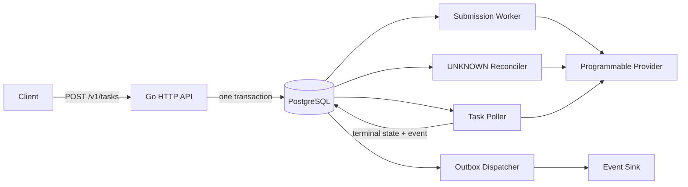
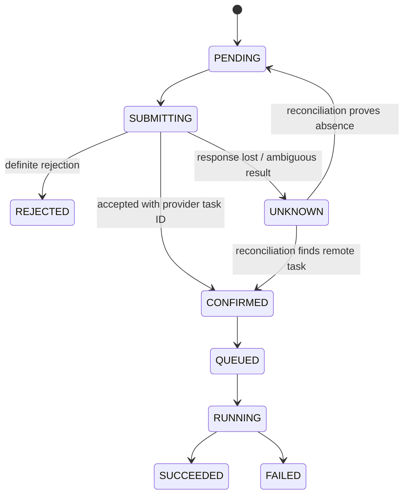

# Model Gateway Lab

Reliable control-plane mechanics for long-running AI generation tasks, implemented in Go and PostgreSQL.

Calling a model API is easy. Deciding what happened after a timeout is not. A provider may have accepted and charged for a video task even though its response never reached the caller. Retrying blindly can create duplicate work; treating the timeout as a failure can leave paid work orphaned.

Model Gateway Lab is a small, executable study of that boundary. It demonstrates how to accept tasks idempotently, transfer work safely between crashed workers, preserve ambiguous provider outcomes, reconcile them later, and deliver terminal events at least once without changing their identity.

No external model account or paid credential is required. A deterministic fake provider reproduces normal completion and “accepted remotely, response lost” behavior locally.

## The system at a glance



The task row is both the lifecycle authority and the durable work intent. Workers claim rows with `FOR UPDATE SKIP LOCKED`, a unique per-attempt fencing token, and an expiry. PostgreSQL—not a process-local queue—is the recovery boundary in v1.

## What is implemented

### Idempotent intake

- `POST /v1/tasks` requires `X-Tenant-ID` and `Idempotency-Key`.
- The request ledger and task are created in one transaction.
- Repeating the same key and canonical request returns the original task.
- Reusing the key with different content returns `409 Conflict`.
- Task reads enforce tenant ownership and return `404` across tenant boundaries.
- The public response model excludes prompts, idempotency keys, request digests, and provider request keys.
- Requests for providers that are not configured are rejected before persistence.

### Lease-safe workers

- Submission, reconciliation, polling, and event delivery use expiring leases.
- A second worker cannot claim live work.
- Every acquisition receives a new fencing token, even when two processes use the same logical worker name.
- An expired submission is moved to `UNKNOWN` for lookup; it is never submitted again until absence is proven.
- Completion by an older attempt is rejected after takeover.
- Poll and delivery retries have an eligibility time, so one failing item cannot hold the queue head.

### `UNKNOWN` as a first-class state



Only a typed definite rejection is treated as rejected. An ambiguous response or an abandoned `SUBMITTING` attempt becomes `UNKNOWN`. Reconciliation by a stable provider request key must find the original task or prove it absent before the control plane submits again.

### Durable terminal events

- Terminal task state and the outbox event are committed atomically.
- Dispatch is at least once.
- A crash after delivery but before the local sent marker causes redelivery with the same deterministic `event_id`.
- Consumers can deduplicate without the project making an exactly-once claim.

## Run the demo

Requirements: Docker with Compose, `curl`, and `jq`.

```bash
make up
make demo
```

Each demo run creates fresh tasks and separately verifies an idempotent replay:

1. `demo-success` follows the normal submit → poll → success path.
2. `demo-lost-response` is accepted by the fake provider, loses the response, enters `UNKNOWN`, is found by reconciliation, and then completes normally.

Expected final shape:

```json
{
  "scenario": "lost-response-reconciled",
  "submission": "CONFIRMED",
  "execution": "SUCCEEDED",
  "output": "artifact://demo/remote_..."
}
```

Stop the local stack with `make down`.

## API example

```bash
curl -X POST http://127.0.0.1:8080/v1/tasks \
  -H 'Content-Type: application/json' \
  -H 'X-Tenant-ID: demo-team' \
  -H 'Idempotency-Key: request-001' \
  -d '{
    "provider": "fake-a",
    "model": "demo-success",
    "operation": "text-to-video",
    "prompt": "a paper boat crossing a quiet lake"
  }'
```

Read the task with:

```bash
curl -H 'X-Tenant-ID: demo-team' \
  http://127.0.0.1:8080/v1/tasks/<task_id>
```

## Verification

```bash
make verify
```

`make verify` checks formatting, runs `go vet`, executes the credential-free unit suite, starts a dedicated PostgreSQL test service on port `55433`, and runs tagged integration tests. It does not stop the demo gateway or truncate the demo database. GitHub Actions runs the same unit, race, vet, and PostgreSQL checks for pushes and pull requests.

The tests cover:

| Claim | Executable evidence |
|---|---|
| same request is replayed; conflicting content is rejected | service, HTTP, and PostgreSQL integration tests |
| abandoned submission becomes `UNKNOWN`; resubmission waits for proven absence | memory and PostgreSQL recovery tests |
| every acquisition is fenced; an older attempt cannot complete | memory and PostgreSQL lease tests |
| lost response becomes `UNKNOWN` and is reconciled | submission and reconciliation tests |
| terminal state and event are one transaction | PostgreSQL terminal/outbox test |
| redelivery retains event identity | memory and PostgreSQL outbox tests |
| retrying one poll/event does not starve unrelated work | memory and PostgreSQL scheduling tests |
| a stale `QUEUED` observation cannot regress a `RUNNING` task | memory and PostgreSQL state-transition tests |
| API responses never return prompts | HTTP create, replay, and read tests |
| fake-provider tasks remain discoverable across gateway restart | deterministic scenario-provider restart test |
| startup does not require a real provider credential | scenario-provider tests and demo |

See [Failure Windows and Executable Guarantees](docs/design/failure-windows.md) for the precise failure model and test names.

## Design choices

**PostgreSQL as queue and source of truth.** This keeps the first release operationally small while still providing transactions, uniqueness, row locking, and recovery. A broker can be added later for throughput; it is not needed to prove the control-plane semantics.

**Typed provider outcomes.** Definite rejection, unknown submission, lookup result, and poll result are separate types. State transitions do not depend on parsing error strings.

**Stable internal contract.** Provider fields are mapped into a small task model. Provider state remains an observation; the local task record is authoritative for ownership and delivery.

**Restart-safe local provider.** The demo provider stores its simulated remote-task state in a dedicated PostgreSQL table. Reconstructing the gateway process therefore preserves both `FOUND` and `ABSENT` lookup semantics, poll progress, and failure outcomes without credentials or an external service.

**No exactly-once language.** The outbox closes the “terminal state committed but event missing” window. It does not remove duplicate delivery, so the event ID is part of the consumer contract.

## Deliberate non-goals

v1 does not implement real provider SDKs, cost/latency routing, cross-provider failover, quota reservation, billing settlement, artifact storage, callbacks, cancellation, or a UI. Those are useful only after the core ambiguity and recovery contract is correct.

## Repository map

```text
cmd/gateway/                 process composition and graceful shutdown
internal/controlplane/       use cases, workers, leases, reconciliation, outbox
internal/provider/           provider port and typed outcomes
internal/fakeprovider/       scripted tests and deterministic demo provider
internal/postgres/           transactional repository and migrations
internal/httpapi/            public task API and tenant boundary
docs/design/                 specification and failure-window analysis
scripts/demo.sh              normal and lost-response walkthrough
```

## Clean-room provenance

This is an independent clean-room project based on general distributed-systems problems encountered in model-platform engineering. It does not contain employer source code, internal APIs, schemas, identifiers, configuration, data, or Git history. Prior work experience and this repository are separate evidence: the former motivates the problem; the latter is the public implementation that can be inspected and run.

## License

[MIT](LICENSE)

